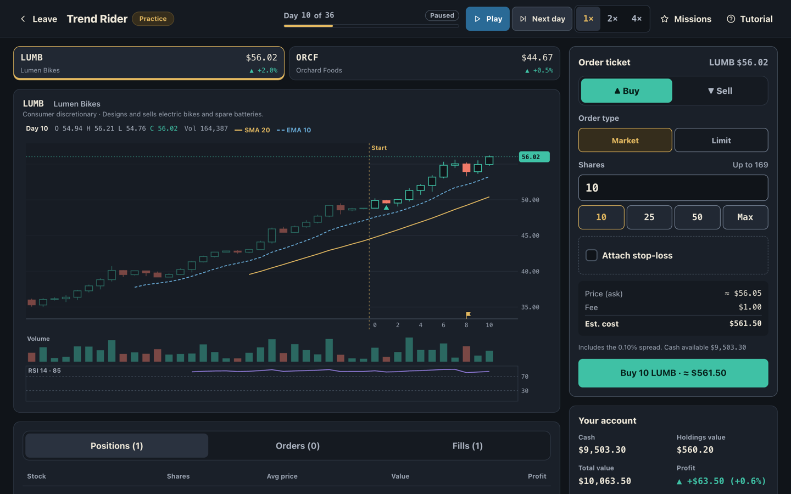
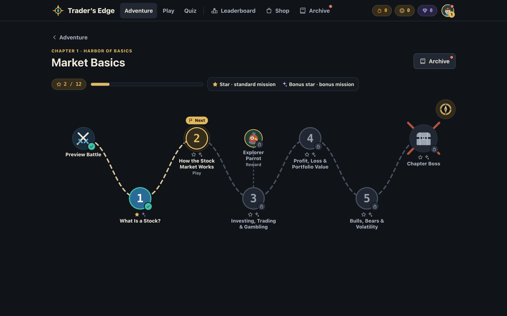
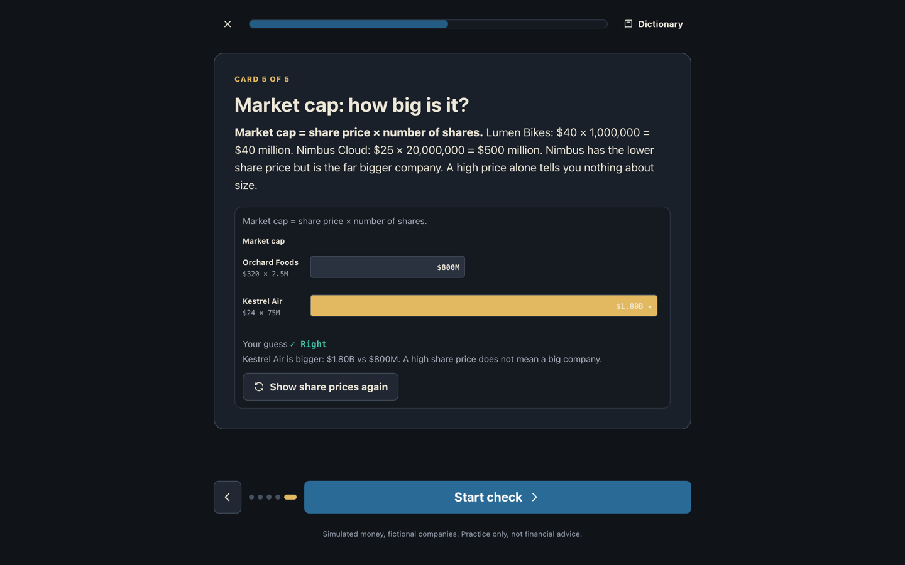
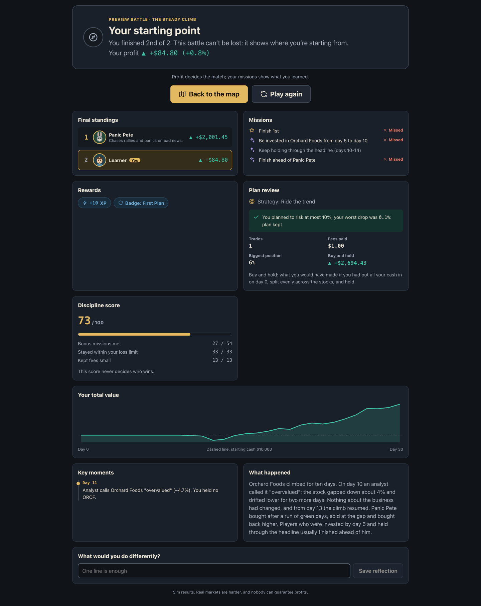

# Trader’s Edge

[](https://github.com/NUS-FinTechAI/traders_edge_v2/actions/workflows/client.yml)
[](https://github.com/NUS-FinTechAI/traders_edge_v2/actions/workflows/server.yml)
[](https://github.com/NUS-FinTechAI/traders_edge_v2/actions/workflows/api-check.yml)
[](https://github.com/NUS-FinTechAI/traders_edge_v2/actions/workflows/postgres.yml)
[](LICENSE)

Trader’s Edge is a trading education game for beginners: short lesson cards,
a quick check, then a trading mission in a simulated market against AI rivals.
All money is simulated and every company is fictional.

The project is for learners practising concepts, instructors running classroom
activities and developers extending trading scenarios. It connects lessons to
missions with recorded decision context, so a match can be examined beyond its
profit result. Markets are seeded simulations and opponents use deterministic
rules; running locally needs no brokerage, market-data service or model API.
Learning effectiveness has not been established.



| Chapter map                                                                             | Lesson card                                                                     | Match results                                                                                          |
| --------------------------------------------------------------------------------------- | ------------------------------------------------------------------------------- | ------------------------------------------------------------------------------------------------------ |
|  |  |  |

Screens from a local guest session on `master` (27 October 2026); they show
simulated play, not a participant study.

## Features

- **Adventure**: 8 chapters × 5 levels on a treasure map, each chapter with a
  Preview Battle and a Chapter Boss; Chapters 2–8 also have a Gate Boss to
  skip ahead.
- **Trading arena**: live candlestick market on a server clock (pause, next
  day, 1×/2×/4×), market, limit and stop-loss orders as they are taught, fees
  and a spread, AI rivals on a profit leaderboard, missions and a results
  screen with key moments.
- **Daily challenge** (after the Chapter 1 boss) and a **practice arena**.
- **Quizzes**: chapter quizzes, daily review, mixed mastery and classroom
  rooms with a join code.
- **Multiplayer**: private lobbies for classes and ranked matchmaking with Elo
  (after the Chapter 3 boss).
- **Profile**: level and rank, badges, avatars, titles, themes, activity
  heatmap, login streak, shop and opt-in leaderboards.

Profit decides every match; XP is never paid for placing orders.

## How it works

- **Lessons gate the tools.** Each level is four or five lesson cards, a
  check that repeats wrong answers until they are right, then a trading
  mission. Limit orders open with Chapter 2 Level 3 and stop-losses with
  Level 4, in the scenario data the engine enforces.
- **The server owns every match.** A match is a scenario, a seed and the
  player's orders. Each read regenerates prices and replays orders and
  rivals to the current day, so future candles, unpublished news and the
  seed never reach the browser, and any match can be replayed exactly.
- **Careless trading loses.** Every fill pays a fee and the spread. A balance
  test in CI plays each boss and daily with idle and random players over 50
  seeds and fails if they win too often.
- **Rivals explain themselves.** 24 rule-based opponents (buy and hold,
  momentum, mean reversion, panic seller, scalper, breakout, news reactor,
  risk manager) trade under the same rules and each has a one-line style.
- **Rewards follow learning, not activity.** XP comes from checks, stars,
  bosses, daily challenges, quizzes and login days; nothing pays for
  orders, trade count or volume. The results screen separates the profit
  ranking from missions, the plan review and key moments.
- **Content is data.** Chapters, scenarios, rivals and the quiz bank are
  JSON validated at startup and in CI, so lessons and markets change through
  reviewed pull requests without engine changes
  ([authoring guide](docs/content/authoring.md)).

## Quick start

Node.js 24+, Python 3.12+ and uv 0.12.23, from the repository root:

```sh
npm ci
npm --prefix client ci
uv sync --project server --extra test --locked
npm run dev
```

In a second terminal:

```sh
uv run --project server --locked python -m uvicorn app.main:app --reload
```

Client: `http://localhost:5173`. API: `http://localhost:8000` (schemas at
`/docs`). Use the same hostname for both so guest cookies work. Local
development uses guest sessions and SQLite (`server/data/learning.db`), with
no Firebase setup required. Follow the [local demo](docs/contributing/demo.md)
for a practice match, the lesson loop and classroom activities.

## Checks

```sh
npm run lint
npm run typecheck
npm run build
npm test
npm run api:check
uv run --project server --extra test --locked python -m unittest discover -s server/tests
uv run --project server --extra test --locked python -m app.content.validate
```

The backend suite includes the balance gauntlet. Live PostgreSQL tests run
only when `TRADERS_EDGE_TEST_POSTGRES_URL` is set
([deployment](docs/operations/deployment.md#live-postgresql-tests)).

## Deploy

The [hosting guide](docs/operations/hosting.md) deploys one free environment:
the API on Render (`render.yaml`), PostgreSQL on Neon, the client on Vercel
(`client/vercel.json`) and sign-in with Firebase. The container image and a
self-hosted Compose stack are in [deployment](docs/operations/deployment.md).

## Documentation

[docs/README.md](docs/README.md) indexes every document. Start with
[ARCHITECTURE.md](ARCHITECTURE.md), the
[game design document](docs/game-design.md) and the
[server guide](server/README.md). Contributors should read
[CONTRIBUTING.md](CONTRIBUTING.md); history is in
the [changelog](CHANGELOG.md).

## Contribute and reuse

Read [CONTRIBUTING.md](CONTRIBUTING.md) before proposing a change. The
[roadmap](docs/open-source/roadmap.md) describes the next work, and the
[release readiness review](docs/open-source/release-readiness.md) records
evidence and outstanding release decisions.

Original project code, documentation and authored content use the
[MIT license](LICENSE). Read the [license scope](LICENSE_SCOPE.md) for supplied
inputs, artwork and third-party material with separate terms. The
[provenance inventory](docs/open-source/release-readiness.md#license-and-provenance)
records the remaining rights and attribution review before a packaged release.

## Status

The game loop, campaign, economy, quizzes and multiplayer are implemented and
tested locally. Not yet done:

- independent financial and pedagogical review of the content (production
  refuses gameplay until it is recorded);
- verified Firebase sign-in on a hosted deployment;
- account deletion, retention rules and researcher access with real accounts
  (the researcher dashboard is checked locally only);
- any measured learning outcome; the decision score is unvalidated.
