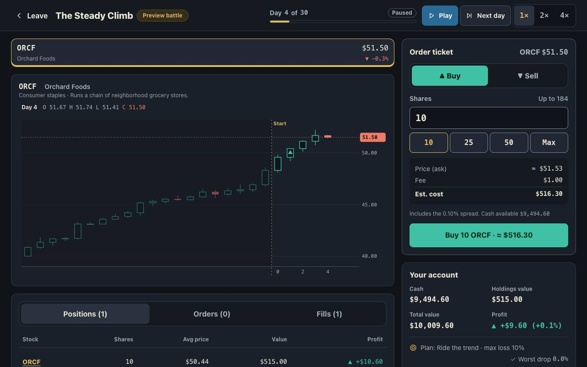

# Trader’s Edge

Trader’s Edge is a trading education game for beginners: short lesson cards,
a quick check, then a trading mission in a simulated market against AI rivals.
All money is simulated and every company is fictional.

The project is for learners practising concepts, instructors running classroom
activities and developers extending trading scenarios. It connects lessons to
missions with recorded decision context, so a match can be examined beyond its
profit result. Markets are seeded simulations and opponents use deterministic
rules; running locally needs no brokerage, market-data service or model API.
Learning effectiveness has not been established.



Existing theme reference capture, described in the
[design system](docs/product/design-system.md#base-themes). This is not evidence
of a current hosted demo or a participant study.

## Features

- **Adventure**: 8 chapters × 5 levels on a treasure map, each chapter with a
  Preview Battle and a Chapter Boss; Chapters 2–8 also have a Gate Boss to
  skip ahead.
- **Trading arena**: live candlestick market on a server clock (pause, next
  day, 1×/2×/4×), market, limit and stop-loss orders as they are taught, fees
  and a spread, AI rivals on a profit leaderboard, missions and a results
  screen with key moments.
- **Daily challenge** (after the Chapter 1 boss) and a **practice arena**.
- **Quizzes**: chapter quizzes, daily review, mixed mastery and classroom
  rooms with a join code.
- **Multiplayer**: private lobbies for classes and ranked matchmaking with Elo
  (after the Chapter 3 boss).
- **Profile**: level and rank, badges, avatars, titles, themes, activity
  heatmap, login streak, shop and opt-in leaderboards.

Profit decides every match; XP is never paid for placing orders.

## Quick start

Node.js 24+, Python 3.12+ and uv 0.12.23, from the repository root:

```sh
npm ci
npm --prefix client ci
uv sync --project server --extra test --locked
npm run dev
```

In a second terminal:

```sh
uv run --project server --locked python -m uvicorn app.main:app --reload
```

Client: `http://localhost:5173`. API: `http://localhost:8000` (schemas at
`/docs`). Use the same hostname for both so guest cookies work. Local
development uses guest sessions and SQLite (`server/data/learning.db`), with
no Firebase setup required. Follow the [local demo](docs/contributing/demo.md)
for a practice match, the lesson loop and classroom activities.

## Checks

```sh
npm run lint
npm run typecheck
npm run build
npm test
npm run api:check
uv run --project server --extra test --locked python -m unittest discover -s server/tests
uv run --project server --extra test --locked python -m app.content.validate
```

The backend suite includes the balance gauntlet. Live PostgreSQL tests run
only when `TRADERS_EDGE_TEST_POSTGRES_URL` is set
([deployment](docs/operations/deployment.md#live-postgresql-tests)).

## Deploy

The [hosting guide](docs/operations/hosting.md) deploys one free environment:
the API on Render (`render.yaml`), PostgreSQL on Neon, the client on Vercel
(`client/vercel.json`) and sign-in with Firebase. The container image and a
self-hosted Compose stack are in [deployment](docs/operations/deployment.md).

## Documentation

[docs/README.md](docs/README.md) indexes every document. Start with
[ARCHITECTURE.md](ARCHITECTURE.md), the
[game design document](docs/game-design.md) and the
[server guide](server/README.md). Contributors should read
[CONTRIBUTING.md](CONTRIBUTING.md); history is in
the [changelog](CHANGELOG.md).

## Contribute and reuse

Read [CONTRIBUTING.md](CONTRIBUTING.md) before proposing a change. The
[roadmap](docs/open-source/roadmap.md) describes the next work, and the
[release readiness review](docs/open-source/release-readiness.md) records
evidence and outstanding release decisions.

The repository does not yet include a project license. A license decision and
confirmation of rights to the included code, content and artwork are required
before describing it as an open-source release. Public visibility alone does
not resolve those decisions.

## Status

The game loop, campaign, economy, quizzes and multiplayer are implemented and
tested locally. Not yet done:

- independent financial and pedagogical review of the content (production
  refuses gameplay until it is recorded);
- verified Firebase sign-in on a hosted deployment;
- account deletion, retention rules and researcher access with real accounts
  (the researcher dashboard is checked locally only);
- any measured learning outcome; the decision score is unvalidated.
